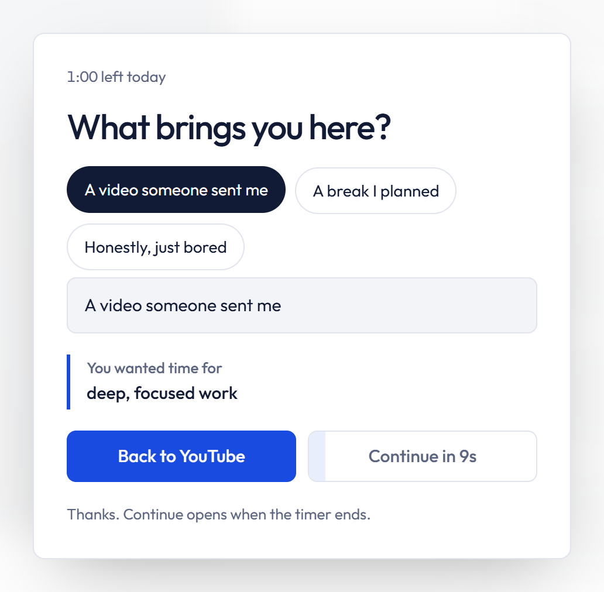

<p align="center">
  
</p>

<h1 align="center">Focus Is All You Need</h1>

<p align="center">
  A Chrome extension that puts a daily limit on YouTube Shorts, Instagram Reels and TikTok,<br>
  so short videos stop taking the time you meant for something else.
</p>

<p align="center">
  <a href="https://github.com/0alfajar/Focus-Is-All-You-Need/releases/latest"><strong>Download</strong></a>
  &nbsp;&nbsp;·&nbsp;&nbsp;
  <a href="#install">Install</a>
  &nbsp;&nbsp;·&nbsp;&nbsp;
  <a href="#privacy-and-permissions">Privacy</a>
</p>

<p align="center">
  
</p>

## Why

Scrolling short videos is mostly habit, not a decision. Willpower in the moment is unreliable, so this extension doesn't depend on it. You set your limits once, while you're calm. A short pause breaks the automatic loop when you reach for a feed. When your time is up, short-form closes until midnight and the rest of the site keeps working.

## Features

- **Daily allowance.** One budget shared across all limited sites. Time counts only while a short-form page is open and visible, and it resets at midnight.
- **A 10-second pause.** Before a feed opens, you pick why you're there with one tap. Going back is the main button, and it never closes your tab.
- **A timer in the corner.** It shows what's left today and turns red in the last minute, so the block never comes as a surprise.
- **A calm block.** Short-form closes until midnight with a plain message, not a scolding. Normal YouTube and Instagram keep working.
- **One emergency pass a day.** Wait 60 seconds, then watch for 5 minutes.
- **Your own sites.** Add any site or path, such as `reddit.com` or `facebook.com/reel`, and choose to block it all day or to limit it with your daily minutes.
- **Settings that protect you.** Stricter changes apply right away. Looser ones wait 24 hours and can be cancelled. A site added by mistake can be fixed or removed within 10 minutes.
- **A 7-day view.** The toolbar popup shows time left, the last week, and how often you left early.
- **Private by design.** No account, no analytics, no network requests. Everything stays in your browser.

## Install

The extension isn't on the Chrome Web Store yet. You can install it in about a minute:

1. Download `focus-is-all-you-need-v1.0.0.zip` from the [latest release](https://github.com/0alfajar/Focus-Is-All-You-Need/releases/latest) and unzip it.
2. Open `chrome://extensions` and turn on **Developer mode** in the top right.
3. Click **Load unpacked** and select the unzipped `focus-is-all-you-need` folder.
4. Pin the extension from the puzzle icon in the toolbar.

A two-step setup opens on first install. It works in Chrome and other Chromium browsers such as Edge, Brave and Arc.

## How it works

| When | What happens |
| --- | --- |
| After install | You choose a daily limit, the sites to limit, and an optional reminder of what you want your time for. |
| You open Shorts, Reels or TikTok | A 10-second pause asks what brings you here and shows your reminder. |
| While you watch | A small timer counts down your minutes for the day. |
| Your minutes run out | Short-form closes until midnight. The rest of the site still works. |
| Something can't wait | One emergency pass a day: a 60-second wait, then 5 minutes. |
| At midnight | Everything resets. |

A visual walkthrough is built into the extension. Open the popup and click **How it works**.

## Privacy and permissions

Settings and usage are stored with `chrome.storage.local` on your device. The extension makes no network requests, and its fonts and icons are bundled.

| Permission | Why it's needed |
| --- | --- |
| `storage` | Save your settings and today's usage. |
| `scripting` | Run on sites you add yourself. |
| Access to youtube.com, instagram.com and tiktok.com | Detect Shorts, Reels and TikTok and show the pause. |
| Optional access to other sites | Requested only when you add a site, and only for that site. |

**Limitations.** An extension can always be turned off at `chrome://extensions`, and Chrome doesn't let an extension prevent that. Incognito windows are covered only if you enable "Allow in Incognito". Reels that play inside the normal Instagram feed aren't counted, only `/reel` and `/reels` pages.

## Development

There is no build step. Clone the repository, load the `extension` folder with **Load unpacked**, and edit the files directly. After a change, click reload on the extension card and refresh any open tabs.

```bash
npm install   # installs Puppeteer and Chrome for Testing
npm test      # end-to-end tests
```

The tests load the extension in Chrome for Testing and click through every screen: setup, the pause, the timer, the block page, the emergency pass, settings and custom sites. Site pages are replaced with stand-ins, so the tests run offline. Each run also regenerates the walkthrough screenshots in `extension/assets/guide/`.

### Project structure

```
extension/
├── manifest.json      Manifest V3
├── background.js      Service worker: settings, usage, rules, tab handling
├── content.js         Runs on limited sites: pause screen, timer, block redirect
├── pages/             Popup, settings, setup, block page, walkthrough
├── shared/            Design tokens (styles.css) and helpers (common.js)
└── assets/            Fonts, icons, walkthrough screenshots
tests/
└── e2e.mjs            End-to-end tests with Puppeteer
```

## Contributing

Issues and pull requests are welcome. Before opening a pull request:

- Run `npm test` and make sure every test passes.
- Keep UI copy short and plain, written from the user's side, and in sentence case.
- Keep the interface free of jargon and citations.

## License

[MIT](LICENSE). The bundled fonts, [Outfit](https://github.com/Outfitio/Outfit-Fonts) and [DM Mono](https://github.com/googlefonts/dm-mono), are licensed under the SIL Open Font License 1.1. Their license files are in `extension/assets/fonts/`.
